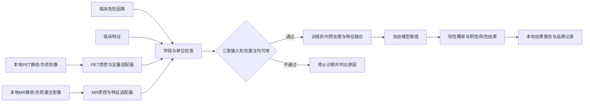
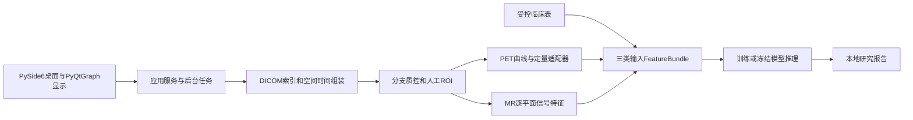

# CMVD 三类输入融合 Demo 设计

本设计以用户于2026-10-19明确的交付目标为依据：**2026-12-31前构建1个融合临床危险因素、临床特征、PET/MR双灌注图像特征的CMVD二分类模型，并在不少于1例独立测试病例上演示完整流程**。80例重建完成数据是用户报告的可用资源，尚未与历史79例清单对账。实现现状、验证和变更仅记录在 [HANDOFF.md](HANDOFF.md)。

## 1. 任务书依据与本次范围

参考原件：`C:\Users\Administrator\Desktop\科大新医学-任务书.pdf`，38个PDF物理页；SHA-256：`6794230f6bf60566dfe5ee48b20dc14c5186a931645d0d1087029e3c2d915ded`。本地Windows OCR读取全部38页；偶数页OCR为空，不能据此断言页面无内容。关键物理页9、11、29另作渲染目视核对。OCR有识别误差，参数落实时回看原图。本文件只提取研究需求，不复制联系人、签名或预算。

| 依据（PDF物理页） | 对本次设计的影响 |
|---|---|
| p7、p9：临床危险因素、临床特征与双灌注图像融合建模 | 三类输入都要进入最终模型；影像类同时覆盖PET灌注和MR灌注 |
| p9、p11：入排标准、一般资料、血常规与生化 | 由临床团队确定病例资格、标签标准及预测时点；资料清单不等于必须全部入模 |
| p13–p19：静息/负荷动态灌注、PET MBF/储备、MR灌注定量及cine等 | 区分灌注必需分支与心功能辅助分支；重建影像不等于已有可信定量结果 |
| p21：融合网络与死亡/心肌梗死预后描述 | 作为历史研究方案参考；不能把该预后终点移作本次CMVD二分类标签 |
| p29：计划训练80例、验证40例，第三年度软件与随访 | 原任务书整体范围更大；本次≥1例演示不代表完成40例验证或整个基金项目验收 |

本次终点是CMVD阴性/阳性。预后随访、死亡/心梗预测、自研重建算法和完整基金考核不纳入首版Demo。任务书内的管理条款是参考资料，不能据此自动执行上传、联系他人、投稿或变更项目管理事项。

## 2. 初步调研与技术判断

1. [2024 ESC慢性冠脉综合征指南](https://www.escardio.org/guidelines/clinical-practice-guidelines/all-esc-practice-guidelines/chronic-coronary-syndromes)及其[核心信息](https://www.escardio.org/static-file/Escardio/Guidelines/Products/Essential%20Messages/2024%20EM/Essential%20Messages_2024%20CCS.pdf)强调ANOCA/INOCA评估，PET用于绝对MBF测量，CMR灌注可作另一种评估途径。推论：需要核实阻塞性病变排除、实际检查协议及CMVD参考标准，不能将现有目录标签当作临床确诊。
2. [SNMMI/ASNC PET心肌血流定量立场文件](https://jnm.snmjournals.org/content/59/2/273)是PET定量方法的参考（2018，DOI `10.2967/jnumed.117.201368`）；本次官网全文访问403，未据此采用具体诊断阈值或动力学参数。PET接入优先核实经质控的工作站MBF/MFR导出，其次再考虑自行实现动力学定量。
3. [TRIPOD+AI官方扩展清单](https://www.tripod-statement.org/wp-content/uploads/2024/04/TRIPODAI-Supplement.pdf)要求交代结局标准、预测变量、缺失处理、样本数、患者级无泄漏划分、模型与阈值、性能及复现条件。推论：先冻结标签和划分，再进行训练；所有需要拟合的预处理仅在训练折内进行。

**工程选择（待真实数据验证）**：约80例优先建立低维、正则化Logistic特征融合基线。先获得可信双灌注特征，再比较更复杂模型；不能因图像切片多而把患者样本量视为足够训练大型3D网络。没有依据承诺准确率、AUC或临床效能。

## 3. 流程与模块边界



| 模块 | 输入 → 输出 | 交付要求 |
|---|---|---|
| 病例索引 | 既有研究编号 → 单患者资料关联 | 复用`metadata/full_case_manifest.csv`；先查表头，不复制第二份病例索引；重复检查同患者保持同一分组 |
| 临床适配器 | 受控临床表 → 危险因素/临床特征 | 明确单位、采集时点、缺失原因；姓名和目录标签不作特征 |
| PET适配器 | 静息/负荷动态影像或本地工作站输出 → MBF、MFR与QC | 记录方法/版本/来源；核实时间帧、活度单位、衰变/衰减校正、输入函数和运动；单纯SUV不能替代MBF |
| MR适配器 | 静息/负荷首过灌注 → 可追溯灌注特征与QC | 核实实际协议；先实现运动校正、ROI与信号时间曲线。归一化上升斜率比为半定量MPRI，不宣称是绝对MBF或定量MPR |
| 辅助影像 | cine、LGE、T1/T2 → 可选补充特征 | LVEF、EDV/ESV可辅助，不替代MR灌注；手工ROI先支撑闭环，自动分割后续接入 |
| 融合训练 | 审核标签、患者划分与特征 → 模型包 | 特征白名单、训练折内拟合、锁定阈值；记录依赖、随机种子与输入版本 |
| 本地演示入口 | 单例输入 → QC、概率、二分类与报告 | 缺少PET或MR灌注时拒绝诊断；真实推理使用冻结模型；不向前端公开数据路径或提供静态数据目录 |

第一阶段可以使用经过审核的工作站/人工ROI特征接入来完成**特征输入到输出**的闭环。最终从重建影像开始的演示仍需补齐并验证影像适配器；不能把手工填写灌注数字称作已完成自动影像端到端系统。

## 4. 数据合同与标签

机器可读合同见 [configs/demo_contract.json](../configs/demo_contract.json)。候选字段是工程接口草案，临床确认后版本化；当前配置供合成输入校验，不是最终CRF或临床阈值。没有新增真实病例清单。

- 危险因素：年龄、高血压、糖尿病、吸烟；性别、BMI、月经史等保留为待讨论候选。
- 临床特征：静息心率、LDL-C作为接口示例；血常规、空腹血糖、NT-proBNP、症状等待确认后扩展。
- PET：静息/负荷MBF，单位`mL/min/g`；MFR为负荷/静息比值，无量纲。
- MR：静息/负荷**归一化**信号上升斜率，统一单位`s^-1`，必须由同一规范的方法产生；MPRI为其比值，无量纲。以后若接入绝对定量需另开合同版本，不混用两种含义。
- 每个灌注分支附`method`、`source_reference`、`qc_status`、`reviewed_by`；实际存储的是本地研究引用和审核者代码，真实身份映射另行受控。
- 病例ID仅关联资料，绝不作为训练特征；POS/NEG前缀不作为诊断输入或标签推导规则。

用户于2026-10-19确认：病例标签来自医院反馈的医生诊断，尚无临床结构表，允许先假设常见参考字段。标签来源已明确，具体诊断标准与逐病例记录仍待提供；后续补齐标准版本、阴性定义、阻塞性病变/痉挛排除依据、判定日期与审核者、分歧处理、预测变量可用时点。标签单独存放于受控位置，不能混进单例推理输入。

候选字典见`configs/clinical_candidate_fields.json`：7个危险因素候选、17个临床特征候选及BMI/PLR两项派生候选。它扩展采集设计，不改变当前合成模型的8项融合特征。`examples/templates/clinical_features.csv`与`diagnosis_labels.csv`仅含表头，无真实病例；标签约定0=医生诊断阴性、1=医生诊断阳性、空值=待定，`label_source`填`hospital_reported_physician_diagnosis`并记录来源引用；不得由POS/NEG前缀自动产生。真实表后续存放于受控`metadata/`，不另复制既有病例索引。

特别检查**循环定义偏倚**：若阳性完全由PET MFR阈值定义，而输入同时包括该MFR，模型可能只学到阈值复刻。应说明参考标准与输入指标的关系，设计相应敏感性/消融分析，不能把这种一致性称为独立诊断能力。

## 5. 训练与评估方案

1. 对账80例与历史79例：确认新增病例、重复就诊和既有编号，不重新排序编号；继承POS-008、NEG-018等既有数据问题。先按临床表和模态可用性统计纳入/排除，不扫描重处理全部像素。
2. 若80例均用于训练，应另取得≥1例从未参与开发的病例；若尚无新增病例，只能在开发前锁定队列内留出病例，同时明确实际训练人数相应减少。队列内独立留出不等于外部验证；独立测试病例来源是待确认事项。
3. 用研究患者ID冻结开发/测试划分；同患者所有模态、切片、时相、重访进入同一集合。测试病例不用于选特征、填补、调参、阈值或人工修改规则。
4. 在开发集作患者级分层交叉验证；折数依据最终较少类别人数确定，必要时减少。首个基线固定L2 Logistic与少量预先指定特征；不在全数据先筛特征。若搜索正则强度/变量/阈值，使用内层交叉验证，外层评估；标准化、填补、特征筛选均在折内拟合。
5. 首版合成骨架对任何缺失值拒绝推理。真实模型再明确预先规定的缺失上限、开发折内填补和缺失指示；整个PET或MR灌注分支缺失，不通过填零伪装为三类融合。
6. 报告患者数、阳性数、缺失与排除；开发集OOF AUC、敏感度、特异度、平衡准确率、混淆矩阵及Brier，按可行性提供患者级不确定性估计；消融比较临床、临床+PET、临床+MR、全融合。先锁定方案，避免小样本反复挑选最优结果。
7. ≥1例测试仅承担功能演示：可展示单例预测与参考结果，不能据单例计算有效AUC或声称泛化/临床验证。若测试集单类别，AUC标记不可计算。最终阈值由开发数据和临床目标预先确定，不能看测试结果调到“演示正确”。

模型包应包含：模型与预处理、合同版本、特征顺序与单位、标签标准、阈值及依据、患者划分引用/摘要、训练数据版本、随机种子、依赖版本、代码版本、评估报告及限制。禁止以不可信pickle文件作为外来模型直接加载。

## 6. Demo交互设计（待实现）

用户已于2026-10-19选择本机桌面应用；桌面技术建议为PySide6+PyQtGraph，影像/定量/模型保持独立Python模块，细化见第9节。本次仅确定设计方向，没有安装或实现桌面界面。

目标使用者为本地研究人员。按“选择研究病例 → 核对两组临床信息 → 查看PET/MR灌注与QC → 执行冻结模型 → 查看/导出本地研究报告”组织。输入不通过时展示具体缺项；通过后显示二分类、阳性概率、模型版本、阈值、输入来源和人工审核情况。单例报告与训练评估分开，合成模式清楚显示“模拟结果”。

先提供可替换的Python领域层和命令行，再接本地界面；数据留在本机。展示图像使用经过专门审查的派生预览；头字段复核不代表像素隐私已通过。报告不自动携带姓名、原始路径或不必要的临床元数据。

## 7. 建议里程碑与验收

以下是按2026-12-31倒排的工程计划，依赖临床资料与环境落实，不是对数据完整性或模型性能的承诺。

| 时间 | 工作 | 退出条件 |
|---|---|---|
| 10/19–11/04 | D0–D2：合同、真实读取、桌面浏览；临床资料并行准备 | 两例空间/时间轴可核对，界面可浏览且操作期间保持响应 |
| 11/05–11/22 | D3–D4：ROI、曲线、双灌注特征与来源核验 | 单例从影像到可追溯特征走通；定量参考与工程/研究容差明确 |
| 11/23–12/06 | D5–D6：开发队列特征、患者级验证与基线 | 特征及标签可审核、无患者泄漏；冻结模型及阈值 |
| 12/07–12/13 | D7：真实模型接桌面与研究报告 | 单例运行、阻断路径、版本追溯与报告一致 |
| 12/14–12/20 | D8：独立病例验收 | ≥1例未参与开发的病例端到端演示，保留预测及失败记录 |
| 12/21–12/31 | D8：交付与复现缓冲 | 离线启动、依赖/模型包、评价及复现说明齐全 |

阶段编号、依赖关系及配套测试见第10节。日期用于倒排和识别延期，不表示临床资料已落实或阶段已完成。

若工作站结果不存在或MR负荷灌注不完整，优先解决定量与协议问题，不能用cine或静态SUV代替双灌注交付。若真实标签与数据尚未落实，合成演示只验收工程接口，不算完成模型或真实独立病例演示。

## 8. 框架入口与后续实现顺序

`scripts/demo/run_demo.py --synthetic-demo`只读取仓库合成样例，按合同校验、计算比值并使用**人工固定的演示系数**输出模拟概率/分类；未训练任何模型，不证明任务目标已完成。不接受任意真实病例输入或输出路径，结果只写入项目`outputs/demo/`下新建的独立运行目录，拒绝覆盖已有目录，失败留存失败记录，不提供续跑。`tests/test_demo_framework.py`覆盖输入拒绝、来源约束与患者隔离等边界。

运行环境移至项目外：`E:\Conda\miniconda3`管理器、`E:\Conda\envs\cmvd\python.exe`项目解释器，安装缓存放在`E:\Conda\cache`。通过`scripts/python.ps1`读取本机`configs/runtime.local.json`调用解释器；机器配置不进Git。`scripts/setup/bootstrap.ps1`按`requirements/windows-py312.lock`重建环境，支持自定义`-RuntimeRoot`及已有缓存的`-Offline`模式；`check_environment.py`检查CPU数值与合成DICOM读写。具体版本、来源和命令见README，当前执行结果仅记在HANDOFF。

开发顺序统一按第10节：真实读取 → 桌面浏览 → ROI/曲线 → 双灌注特征 → 开发队列 → 训练与冻结 → 集成报告 → 独立验收。临床合同、逐病例诊断和测试病例准备从D0并行，不阻塞读取/浏览开发；进入真实训练前必须具备真实资料和合格特征。不要扩大合成系数用途或为患者编造临床值。

## 9. 根据两例实际样本收敛技术栈

### 样本事实及其设计约束

入口是已重建、未去标识/未分析的临床DICOM影像；本次两个样例均为`.IMA`文件，不是PET list-mode或MR k-space输入。顶层仅计数到31个阳性7z、48个阴性7z，各有一个解压样例；未打开压缩包。两例分别8,126/8,151个对象、45/50个SeriesInstanceUID；其中PT各7,112个，MR分别1,010/1,034个，其余为NM/OT Secondary Capture。本次2例16,277个头字段读取/汇总完成，不能外推为79/80例已核验。

| 实际结构（两例均观察到） | 工程决策 |
|---|---|
| PET静息和负荷各127层、172×172、19个动态时间帧；各动态序列2,413个空间-时间单元齐备、无重复对象 | 按位置/方向与时间联合组装`[t,z,y,x]`；静态、门控、动态分别入型，不能混装 |
| PET另有静态127张和8门控×127层；像素单位BQML、DecayCorrection=START、半衰期597.9s、注射剂量/起始时间字段存在 | 保留原始定量及时间元数据；参数存在不等于动力学定量已正确或已取得MBF |
| PET19帧时长为12×10s、2×30s、4×60s、1×180s，总600s；参考时间不总等于简单帧中点 | 时间使用实际DICOM字段，明确参考时刻和衰变约定，再处理输入函数/拟合；不按等间隔19帧计算 |
| MR静息/负荷各4组单平面×70张；方向与cine比较支持3个短轴候选平面+1个长轴候选平面 | 每个平面独立保留`[t,y,x]`和几何，短轴层级需人工确认；不伪造为连续3D灌注体积 |
| MR灌注70个实际采集时点，时间间隔随病例和静息/负荷变化；观察范围约0.635–3.395s/步 | 斜率、TTP和配准使用真实时间轴；显示帧数与物理时间分开 |
| cine短轴10层，每层独立Series、25时相、208×174；层厚8mm、层中心距10mm；各层触发时间网格并不完全一致 | 跨Series组装，保存逐层触发时间；基于周期信息规范化相位并人工核验，不能用层厚直接代替层距 |
| 样本另有T1/T2、PSIR等序列；存在有效的Secondary Capture对象且SeriesNumber可为空 | 序列索引按UID和实际几何/内容；SeriesNumber只作辅助。截图/报告单独归类，不进入原生MR/PT像素通道 |

PET单个动态序列按float32装载约272 MiB，静息+负荷仅动态部分约545 MiB。因此采用按需解码、逐序列处理和受控磁盘缓存，不把全部病例和模态一次加载到内存。检查器只输出技术字段和少量原生像素预览；原始身份字段、自由文本和UID不写入摘要。预览仍是受控研究派生物，未完成像素隐私检查或临床诊断。

空间与时间处理依据[DICOM图像平面定义](https://dicom.nema.org/medical/dicom/current/output/chtml/part03/sect_C.7.6.2.html)和[PET Image Module](https://dicom.nema.org/medical/dicom/current/output/chtml/part03/sect_C.8.9.4.html)：层厚与空间位置不是同一概念，FrameReferenceTime含义也不能简单等同任意序列的帧中点。

### 首版选型建议

| 层 | 技术 | 本项目职责 |
|---|---|---|
| 语言与环境 | Python 3.12、现有E盘Conda专用环境 | 复用现有科学计算环境，具体新增版本在实现时验证并锁定 |
| 桌面界面 | PySide6 / Qt Widgets | 病例工作区、临床表、序列树、分支QC、模型结果与本地报告 |
| 图像/曲线交互 | PyQtGraph | 层面/时间滑块、窗宽窗位、ROI人工勾画修正、TAC/信号时间曲线；4D数据由应用显式选择切片与时相 |
| DICOM读取与组装 | pydicom + NumPy | 按UID/几何/时间索引、必要像素解码、单位换算、缺层/重复/可空字段检查 |
| 配准与图像运算 | SimpleITK + SciPy | 按单帧2D/3D处理运动与重采样、滤波、曲线计算；保留物理坐标与原始定量数组 |
| 表格与特征融合 | pandas + scikit-learn Pipeline | 临床表校验、双灌注特征合并、训练折内填补/标准化、正则化Logistic、患者级验证 |
| 评价与导出 | JSON/CSV、Matplotlib、后续Qt PDF导出 | 保存可复算的特征与QC；离线输出ROC/校准图及单例研究报告 |
| 后续自动分割 | 可替换接口，候选PyTorch+MONAI | 首版先接手工/半自动ROI；权重、标注、目标模态及GPU核实后再确定网络与依赖 |

[Qt Widgets](https://doc.qt.io/qtforpython-6/PySide6/QtWidgets/index.html)提供桌面控件；[PyQtGraph ImageView](https://pyqtgraph.readthedocs.io/en/latest/api_reference/widgets/imageview.html)及[ROI](https://pyqtgraph.readthedocs.io/en/latest/api_reference/graphicsItems/roi.html)支持图像序列、交互区域和曲线，适合作为本项目本地工作站的显示基础。设置明确的row-major像素顺序与物理方向，避免显示转置；显示窗位/归一化不改变定量通道。

[SimpleITK Image](https://simpleitk.org/doxygen/latest/html/classitk_1_1simple_1_1Image.html)显式保留origin/spacing/direction；本项目按帧调用其处理，时间轴由领域对象管理。[scikit-learn Pipeline](https://scikit-learn.org/stable/modules/generated/sklearn.pipeline.Pipeline.html)、[患者分组折分](https://scikit-learn.org/stable/modules/generated/sklearn.model_selection.StratifiedGroupKFold.html)和[数据泄漏实践](https://scikit-learn.org/stable/common_pitfalls.html)为训练实现依据；[MONAI](https://github.com/Project-MONAI/MONAI)只是后续影像深度学习候选，不能据其框架能力宣称已有适用的心肌分割权重或诊断模型。

本节为分层选型；各依赖的实际安装版本见requirements与HANDOFF。Qt显示依赖在D2实现时锁定；SimpleITK、Matplotlib与深度学习栈按实际后续任务引入。现有合成8维合同是接口样例，不能当作已经从影像得到的最终特征集合。

### 模块及数据对象

采用单机分层模块，桌面通过后台worker调用应用服务；计算任务提供进度/取消，工作线程不直接修改界面。无需为首版引入独立Web服务或数据库运维；病例关联复用既有清单，受控特征表提供新增研究信息。



后续按实际实现扩展`src/cmvd_demo/`的`io`、`processing`、`features`、`modeling`、`ui`和`reporting`模块，暂不创建空目录。核心数据对象不得依赖Qt：

- `PetDynamicVolume`：`data[t,z,y,x]`、LPS几何、逐帧参考时间/时长、单位及定量元数据。
- `CineStack`：`data[z,phase,y,x]`、逐层位置/方向和触发时间；周期相位映射、缺层和覆盖QC独立保存。
- `MrPerfusionPlane`：`data[t,y,x]`、平面位置/方向、真实相对采集时间、静息/负荷和待审核的平面角色。
- `FeatureBundle`：三类输入、单位、来源、方法版本和QC；患者关联键不进入模型特征。

内部图像缓存可先用`.npy`/memmap与JSON侧车，侧车保留时间和物理坐标；NIfTI用于需要时与3D Slicer交换，转换不能丢弃时间/单位信息。显示通道与定量通道分开，原始DICOM只读。

### 先实现的闭环及研究待定项

第一步交付真实样例的桌面浏览：序列树、PET静息/负荷动态切片、MR逐平面灌注播放、cine跨层/时相、可修正ROI和原始曲线；从这里核验几何和时间轴，再接入临床表和真实融合模型。先在每例明确三类输入可用性与QC，失败时不输出诊断。

PET MBF/MFR优先接审核过的工作站结果，并与本地TAC/元数据核对；自主动力学需要输入函数、时间/衰变、运动及模型标定验证。MR先实现逐平面运动校正、ROI曲线、上升斜率/峰值/TTP；半定量储备指标需先统一剂量/归一化与采集规则，不能称为已实现绝对MBF。两条研究路径尚不能仅凭DICOM头存在而视为验证完成。

UI方向已由用户确定，Qt/影像/模型模块按本节建议收敛。后续先锁定实际依赖版本并构建真实序列读取层，再实现桌面浏览骨架；待医院补充临床数据与逐病例诊断记录后启动真实训练。80/79例差异、定量参考来源及独立测试病例仍需核实。

## 10. 开发链与测试链

本节定义后续工作包、验收条件与触发测试，执行状态只记在HANDOFF。各阶段先通过对应检查再扩大范围；真实工程闭环、模型研究评价及独立病例演示分别留证。日期参照第7节，新增依赖在实际实现阶段安装并固定，当前计划不触发数据重处理。

### 开发链：D0–D8

| 阶段 | 开发内容与交付物 | 依赖及通过条件 | 对应测试 |
|---|---|---|---|
| D0 合同与边界 | 确认核心数据对象、单位、输入/输出、错误状态、标签与特征分离；确定首版人工ROI流程；规划新增依赖和受控输出 | 工程合同先形成可运行版本；开始索取临床表、诊断依据、定量参考及独立病例。候选字段与真实患者值明确区分 | T0 合同/环境检查 |
| D1 真实DICOM读取 | 实现索引、分组、空间/时间组装、按需像素读取和QC；交付可供CLI/桌面共用的读取服务 | D0。两例数据可按实际类型读取；PET动态/门控/静态、MR逐平面灌注、cine跨Series清晰分开；缺层/重复/不支持对象有明确状态 | T1 合成DICOM与T2两例回归 |
| D2 桌面浏览 | PySide6工作区、序列树、PET层面/时间控制、MR平面/时间控制、cine层面/相位、窗位、后台进度/取消 | D1接口稳定后接真实数据；界面骨架可先用合成数据开发。显示坐标与数据一致，加载不阻塞窗口；没有模型时显示“模型未配置” | T3 界面自动检查与本机交互检查 |
| D3 ROI与原始曲线 | 心肌/血池ROI勾画修正、保存/重载、必要运动校正、TAC/信号时间曲线、逐分支QC | D1–D2。同一ROI可重现曲线；显示归一化与数值通道分开；真实时间/单位传到后续计算 | T4 曲线/ROI数值与人工复核 |
| D4 PET/MR特征 | PET审核工作站结果适配器及本地曲线核对；MR逐平面灌注特征；输出带来源、方法、单位和QC的FeatureBundle | D3及可用定量参考。先完成一例影像→特征闭环，再用第二例检验结构泛化；不把未经验证的TAC参数命名为MBF，不用cine替代MR灌注 | T4 参考测量比较、单位/时间检查和特征拒绝路径 |
| D5 开发队列整理 | 复用既有研究编号/清单，准备受控临床表、医生标签及开发病例特征矩阵；记录纳入、排除与缺失；冻结患者划分 | D4流程固定、真实临床资料就绪。对账79/80例，不因排序重编号；独立测试患者全部记录排除出开发。需再处理影像时先规划独立输出/映射/失败恢复 | T5 关联/覆盖/划分检查；逐病例分支QC |
| D6 训练与冻结 | 低维正则化Logistic基线、训练折内预处理、患者级交叉验证、三类输入消融、开发集阈值与模型包 | D5。输入真实、标签有来源；所有可学习预处理仅拟合开发训练折；完整模型包可加载复算；研究评价与局限如实报告，未设置无依据的AUC承诺 | T6 无泄漏、指标/序列化一致性及模型包检查 |
| D7 桌面集成与报告 | 冻结模型推理接入、临床信息核对、双灌注QC、概率/二分类、报告及本地追溯记录 | D6。同一输入在CLI/桌面/报告输出一致；无模型、缺模态或QC失败时拒绝诊断，结果不可误贴到另一病例 | T7 开发病例端到端及故障注入 |
| D8 独立验收与交付 | 用≥1例独立病例演示输入→影像处理→特征→模型→报告；整理版本、依赖、模型包与离线复现说明 | D7且冻结后才使用独立病例。先独立测试，再做交付复现；以真实流程、预测记录和覆盖/失败项验收，单例不用于宣称临床泛化 | T8 独立流程、运行环境复现与交付检查 |

D2界面骨架可在D1接口确定后接入；执行状态见HANDOFF。用户授权的D3工程开发可先输出未审核预览；将真实ROI测量视为已审核结果前，须完成D1–D2几何/显示人工核对。自动分割、复杂影像网络和完整心功能分析安排在主链稳定后，作为可替换的增量功能，不占用首版三类融合闭环的关键路径。

### 数据与研究资料支线：从D0同时推进

| 支线 | 需要落实的内容 | 最晚影响的阶段 |
|---|---|---|
| 病例与标签 | 既有编号映射、79/80例对账、逐病例医生诊断、标准/判定时点、同患者多检查关联 | D5关联与D6训练；不得从POS/NEG前缀自动生成标签 |
| 两组临床输入 | 医院实际可提供字段、单位、采集时点、缺失原因；候选字段落成真实临床表 | D5；允许调整合同后版本化，不允许用假设值补成真实患者记录 |
| PET/MR参考 | PET工作站导出可用性、MR定量或半定量方法、ROI与测量审核方式、参考比较容差 | D4。若缺参考，先保留曲线/探索性特征并明确范围，重新评估定量工作量 |
| 独立测试 | 决定另取新病例或开发前队列内留出、真实人数、资料可用性与患者隔离 | D5划分前锁定。80例全用于训练时另需测试病例；现有两例调试样本属于开发数据 |

建议10/25前核对标签/临床字段和独立患者来源，11/08前确定定量参考路径；未落实时更新风险和排期，不把缺失条件当作通过。资料支线延迟不妨碍D1–D3工程开发，但会阻塞相关的真实特征验收或训练。

### 测试链：每阶段随开发执行

| 编号 | 输入和检查方法 | 通过证据 |
|---|---|---|
| T0 合同与环境 | 合成输入验证字段/单位、缺失、非有限值和错误状态；环境导入、锁定依赖；验证合成系数拒绝真实病例 | 单元检查与环境摘要；现有9项测试只覆盖合成合同/固定系数/患者分区边界，不覆盖以下真实影像功能 |
| T1 读取单元/集成 | 小型合成DICOM编码已知层面/时间像素，故意打乱文件顺序；不同UID共用SeriesNumber、空Type 2字段、缺层、重复、方向翻转、不同时间间隔 | 组装后的轴、像素单元、几何和时间符合预设真值；异常被识别而非悄悄补零。样例尺寸不硬编码成全队列限制 |
| T2 两例真实回归 | 用当前两例做开发回归，检查实际Series归类、PET空间时间单元、MR平面、cine跨层触发时间；少量帧与独立查看器/人工核对 | 数据版本固定时与现有报告一致；身份/自由文本不进入公开日志；人工确认覆盖和显示方向。不能仅凭头计数宣称图像正确 |
| T3 桌面 | 合成小数组做滑块/窗位/病例切换/任务状态自动检查；在本机用两例人工操作加载、取消、关闭、重开 | 窗口在加载期间可响应；取消后不发布过期结果；像素方向/ROI位置正确。无界面模式测试不能代替Windows人工交互检查 |
| T4 ROI/曲线/特征 | 合成ROI和已知非等间隔曲线验证均值、单位、斜率/峰值/比值；配准用已知变换及真实ROI人工复核；定量与审核过的参考比较 | 工程数值容差和临床/研究参考容差分别预设。参考未获审核则标记未验证；单位错、分母非正、缺帧或分支QC失败时阻断对应特征/诊断 |
| T5 队列 | 检查患者关联、一对多检查、标签/输入分离、各分支可用性、缺失与排除；逐折比较患者集合 | 每折/独立测试无患者交叉，文件数与患者数分别报告；没有复制重编号。缺失分支不被填成正常值 |
| T6 模型 | 验证填补/标准化/筛选只拟合训练折；用独立构造的测试分布确认不会改变训练统计量；核对指标、固定种子和保存前后推理 | 开发集OOF预测与指标可复算，特征顺序/单位/模型版本匹配；单类别AUC记不可计算。模型与阈值冻结后生成版本记录 |
| T7 集成及异常 | 开发病例走全链；注入缺MR/PET、临床缺项、错误单位、QC失败、模型合同不匹配、缓存过期和报告写入失败 | 成功路径CLI/桌面/报告结果一致；失败路径保留原因且不误报阴性/阳性、不覆盖旧结果、不将上个患者结果显示给当前患者 |
| T8 独立与交付 | 冻结后对未参与开发病例实际执行全链，保存首次结果/参考诊断和各步版本；按锁定依赖与模型包在交付运行目录复现启动 | ≥1例真实独立病例流程记录；软件交付不依赖开发者临时目录或运行时联网下载。结果与参考诊断不一致要报告，不能改阈值让演示“正确” |

工程检查为可重复性与实现正确性提供证据，研究测量审核与模型性能另行评价；“测试通过”应写清是哪一层。独立病例若因结果被用于修改特征、模型或阈值，应改列开发病例并另取测试病例；纯启动/报告等基础设施修复记录版本与原因，不能混作模型重新调参。

### 执行和记录约定

- 每个工作包交付代码/配置、对应测试、运行摘要与已知失败项；在HANDOFF更新当前阶段、验证证据及下一项，不新建重复进度文档。
- 开发测试使用合成小数据及受控本地两例；真实影像、ROI、路径映射和临床表不进入Git。独立测试患者不加入工程调试清单。
- 修改后先跑受影响的检查；接口变化跑相关集成检查，版本冻结时跑完整软件回归。全队列处理是另一个受控长任务，不随UI/路径/文档修改自动触发。
- 全队列长任务逐病例输出状态与失败原因，进度反馈不超过60秒；重跑先明确输出和编号映射，不能因现有检查器无续查而原地覆盖。任何全量完成声明须有结束报告。
- 依次交付三个可检查版本：**A真实影像浏览/ROI曲线（D1–D3）→B三类特征与经评价的模型（D4–D6）→C独立病例诊断演示及交付（D7–D8）**。A可先用真实影像验证工程，B/C依赖真实临床资料，合成模式始终单独标记。

## 11. D1读取接口

`src/cmvd_demo/io/`提供与界面无关的只读服务，不执行原始采集重建、去标识、归一化、MBF计算或诊断：

| 接口 | 输入与输出 |
|---|---|
| `scan_case(case_dir, progress=None, cancel=None)` | 显式单病例目录；按Study/Series UID分组，返回Series与逐文件Issue；压缩包不打开，目录前缀不推导诊断标签 |
| `build_grid(series)` | 原生单帧PET动态/静态/门控、MR逐平面灌注/cine；校验后返回懒加载ImageGrid，异常不补零 |
| `build_cine_stack(series_list)` | 显式选中的同Study/FrameOfReference短轴cine Series；按物理层位合并，保留每层触发时间，不宣称相位同步 |
| `grid.read_plane(t, z)` / `grid.materialize(...)` | 按需解码/单网格加载float32定量值；后者默认单数组512 MiB预算，支持进度/取消 |
| `read_pixels(header, scaled=True)` | 单对象像素；逐对象应用slope/intercept，PET要求单位与缩放，MONOCHROME1反相交给显示层 |

数组轴为`[时间或相位序号, 层面, 行, 列]`；`times_s`和动态PET帧长为`[层面, 时间]`。MR灌注使用真实非等间隔采集时间并减去本Series首时点；不同平面时间零点不能据此当作同一绝对起点。PET保留FrameReferenceTime和ActualFrameDuration，不能把衰变相关参考时刻简单替换为帧中点。cine的触发时间直接保留，跨层相位序号不是同步结果。

坐标使用DICOM LPS：`origin[z] + IOP[:3] * column * PixelSpacing[1] + IOP[3:] * row * PixelSpacing[0]`；提供`pixel_to_lps`/`lps_to_pixel`。层中心距独立于SliceThickness，不以文件名或InstanceNumber排序。依据见[DICOM Image Plane](https://dicom.nema.org/medical/dicom/current/output/chtml/part03/sect_C.7.6.2.html)、[PET Image Module](https://dicom.nema.org/medical/dicom/current/output/chtml/part03/sect_C.8.9.4.html)及[pydicom像素解码说明](https://pydicom.github.io/pydicom/stable/tutorials/pixel_data/introduction.html)。

`progress(stage, done, total)`只传计数；`cancel()`为真时抛出`ReadCancelled`，不返回部分成功对象。桌面线程还需按任务版本丢弃过期结果。物化预算约束单个输出数组，不保证进程总内存低于512 MiB；D2优先按需读取并限制缓存。原路径/UID/绝对日期仅保留内存对象中，`safe_summary()`不输出这些字段；摘要依然按研究资料受控保存。

缺失时间、重复对象/单元、不一致几何或定量单位、已声明但缺失的层/帧、读取后源文件变化均显式报错。若整层/整帧缺失且无数量/间距等证据，单凭剩余头字段无法证明缺失。截图、Enhanced/多帧及其他SOP可索引但拒绝主线组装；其他MR尚不提供通用体积组装，压缩传输语法也未验收。分类使用头字段与协议词候选，需要人工确认静息/负荷和序列用途，不代表临床审核。

回归脚本`validate_reader.py --samples`只针对当前两例开发样本执行结构断言与主线像素解码，逐网格释放数组；失败写入报告并返回非零退出码，不覆盖既有报告。它不是全队列审计或独立测试，人工方向对照、像素隐私和临床定量分别验收。

## 12. D2桌面浏览

入口`scripts/desktop/start.ps1`通过统一解释器启动`run_desktop.py`，默认空工作区；`--synthetic`为完全虚构的方向/时间体模，`--case-dir`为显式单病例目录。无网络服务、自动解压、持久病例索引或诊断调用。桌面源码在`src/cmvd_demo/desktop/`，与D1读取及合成推理分开。

- 序列树按静息/负荷候选分组，显示安全序列号与用途，不显示姓名、原路径或UID；不可显示对象置灰保留计数。MR灌注保持逐平面Series；同Study/FrameOfReference/方向的短轴cine生成组合候选，由用户选择后调用D1再次校验，不把所有cine自动合并。
- 所有DICOM索引、组装和像素读取在后台执行；前台请求通道为一个运行任务加一个可替换的最新待执行任务，带取消标记和请求版本。切换病例/序列、滑块请求和取消都会失效旧任务；只有当前版本可更新图像或缓存。另有一个可取消预读通道，不阻塞前台单帧请求；关闭窗口先隐藏，两个通道的在读操作返回后退出，不能强行中断正在进行的单次系统I/O。
- 只按需读取单帧，64 MiB LRU缓存；单帧float32输出上限16 MiB，在解码前检查。展示新帧后最多预读后续4帧（静态序列预读相邻层），大帧自动减少预读数；共用现有缓存预算，过期预读不入缓存。缓存命中仍在后台核对源文件size/mtime；换病例/关闭清空缓存。限制不等于进程总内存保证，后台临时批次/解码另占内存，未建立整幅4D磁盘缓存。
- 图像按row-major、上到下行序显示；通过行/列PixelSpacing保持物理比例。像素中心与DICOM坐标一致（首像素中心位于图像本地0.5/0.5，显示矩形起点为负半间距），鼠标可查看原始定量值和LPS坐标。方向标注基于IOP的主要/次要LPS分量；保留原始采集平面，不自动重排成标准轴位。独立查看器方向核对未完成时，D3结果仅作为未审核预览。
- 窗宽/窗位、百分位自动窗、MONOCHROME1显示LUT不改变定量数组；手动窗位与缩放在逐帧切换时保留。几何变换与灰阶LUT不在每帧重复构建。PET显示参考时间/帧长，MR显示真实相对时间，cine显示当前层触发时间并提示未同步。
- 同网格切帧保留上一幅有效影像、指针与实际时间/层面标签，状态栏另示目标；新帧完成读取后整体替换。连续拖动按45 ms限频合并请求，松手立即加载最终位置，不因持续重启防抖而一直无预览。换病例/序列、主动取消或读取失败仍清空图像。
- 播放使用单次定时器：`PresentedImageItem.paint()`调用基类绘制后确认本帧，再等待设定间隔并请求下一帧；不以`sigImageChanged`当作已绘制，不在定时器上无条件跳帧。默认15 fps，可设1–30；读取或绘制慢时降低实际速度，快拖主动暂停播放。此确认仅代表Qt绘制完成，不保证显示器扫描输出、垂直同步或其他机器帧率；浏览速度不模拟采集速度。
- 失败/取消清除影像，不输出阴性或阳性；双击序列/回车可重试。无模型显示“模型未配置”，不提供诊断按钮；D3的ROI/曲线工作区见第13节。

Qt后台模型参考[Qt QThreadPool文档](https://doc.qt.io/qtforpython-6.10/PySide6/QtCore/QThreadPool.html)，显示轴/矩形变换参考[PyQtGraph ImageItem文档](https://pyqtgraph.readthedocs.io/en/pyqtgraph-0.14.0/api_reference/graphicsItems/imageitem.html)。版本固定于requirements，执行状态只记HANDOFF。

`tests/test_desktop.py`用已知不对称体模验证方向、像素中心、非等间距比例、原值/显示分离、非均匀时间、缓存、后台响应、取消/过期消息、重试和关闭/重开。`check_desktop.py --samples`在原生Qt窗口按主线序列检查真实首末帧，与源对象独立解码/缩放算术核对；只保存合成截图。自动等待用QEventLoop让后台I/O持续运行；QTest仅用于具体控件动作，避免紧密qWait轮询拖慢后台枚举。自动交互不替代T2独立查看器比较、T3人工验收或临床验证。

`--samples --navigation`另检查每例PET动态、MR灌注、cine各一组：连续8帧的Qt绘制顺序/间隔、等待期间空白观察、51次快速目标变更与松手后的最终源像素匹配。软件测试用延迟读取和禁止viewport更新验证未绘制帧不会推进，并检查保留原帧/标签、预读缓存及旧病例清理。帧率只报告测量结果，不作为未经验证的全队列速度承诺。

## 13. D3人工ROI与原始曲线

领域层位于`src/cmvd_demo/roi/`，不依赖Qt；桌面`RoiPanel`复用D1单帧读取，使用独立可取消任务计算曲线/读写快照。只计算当前选中层面，不将不同MR平面时间零点或cine层间相位强行同步。初始几何轮廓不是自动分割或解剖标注；真实方向/覆盖、轮廓与运动仍需人核对。

| 对象/接口 | 约定 |
|---|---|
| `new_document(grid)` | schema v1、用途、来源绑定、ROI轨迹与两个默认false的本地复核项 |
| `binding_for(grid)` | DICOM技术身份/size-mtime/定量头字段的SHA-256签名，另保留形状、LPS几何、单位、逐层时间/帧长；不保存原路径、姓名、原始UID或绝对日期 |
| `set_track(...,frame_only=False)` | 每层最多心肌/血池各一条轨迹；参考帧/轮廓与显式逐帧覆盖。参考改动影响未单独修正帧，既有逐帧覆盖保留 |
| `contour_mask(contour,shape)` | 顶点为`[row,column]`，整数代表像素中心；外多边形可含内膜排除，按像素中心选取，外边界包含、内边界排除 |
| `extract_curves(grid,doc,z,...)` | 当前层完整时序，输出均值/总体标准差/最小最大、像素数/面积、真实时间/帧长/单位、方法版本和QC；失败不返回部分成功曲线 |
| `save_snapshot(root,doc,result)` / `load_document(path,binding)` | 不覆盖的独立新快照；重载时严格核对当前来源/几何/时间；旧ROI版本与新曲线版本不一致拒绝导出 |

坐标转换：编辑器轮廓挂在ImageItem之下，本地`(x,y)=(column+0.5,row+0.5)`；保存时减去半像素并交换为RC。实际LPS沿用D1的IOP/PixelSpacing/origin，不用截图坐标取样。物理面积为有效像素数×行间距×列间距；统计使用D1定量float32像素、float64累计，与窗宽/窗位、MONOCHROME1显示LUT无关。数据不做时间平滑、插值、信号归一化或图像重采样；PET BQML均值不是MBF或SUV，MR输出是原始信号强度。

运动处理采用**固定参考轮廓加逐帧手工覆盖**，覆盖之间不插值，也不跨层/跨序列传播。可在某帧调整心肌内外边界与血池；需复核的帧逐帧修改，未修改帧明确沿用参考。暂不提供未经审核的自动配准/自动分割。软件测试以已知平移的亮块验证手工修正后的曲线；不能据此声称真实心肌运动已验证。

轮廓要求有限、在图像边界内、不自交、有有效像素；内轮廓必须严格位于外轮廓内。计算时心肌/血池不能重叠。单轮廓最多128顶点，文档最多1024轨迹；逐帧掩膜缓存限制16 MiB，原始图像按帧读取，不加载整幅4D。固定/已接受轮廓采用常驻Qt编辑对象复用，切换隐藏再更新，避免在频繁重建PolyLineROI子图时出现原生对象生命周期问题。

鼠标工具分为“编辑ROI控制点”“移动整个ROI”“平移图像”。放置或重载ROI自动进入控制点工具：控制点屏幕半径8 px，只显示当前可编辑角色的控制点；左键未命中时由ViewBox消费，不平移背景或整体轮廓，也不通过Alt/Shift对轮廓旋转/缩放。整体移动工具只启用当前角色的轮廓平移并隐藏控制点，边线拖动转发给对应父ROI，心肌内外边界等量联动并共同计为一步；平移图像工具锁定所有ROI。中键平移、滚轮缩放仍可用。继承已固定PyQtGraph 0.14的Handle/线段实现，显式排除禁用轮廓参与hover/drag，避免自定义GraphicsScene绕过Qt禁用状态或线段吞掉拖动。

`roi/history.py`提供无Qt的几何历史：每次有效操作记录修改前后tracks及帧/层/角色/参考或本帧模式，不保存复核状态或旧曲线；按序列隔离，整个当前病例合计最多50操作/16 MiB序列化内容，超限裁剪旧历史，单步超限清空该序列历史以免跨过未记录修改。一次拖动直到松手才提交一步，增删顶点屏蔽库内部中间信号后原子提交。支持放置/删除、内膜开关、逐帧覆盖/重置、重载；空操作不入栈，新编辑清除本序列redo。撤销/重做恢复目标编辑帧和角色，保留来源绑定，全部本地复核置false并取消过期任务/清除曲线；失效D4特征不因撤销而恢复。无效编辑不进历史，可按撤销回最后有效轮廓。病例切换/关闭不保留历史；同病例切回序列可继续，来源绑定变化则清该序列历史。文本输入控件保留其原生文本撤销，ROI快捷键为Ctrl+Z/Ctrl+Y/Ctrl+Shift+Z。

ROI修改立即使旧曲线和两个本地复核项失效；快拖保留上一帧时，ROI也保留对应旧帧，目标尚未接受时禁用编辑。开始拖动ROI会停止播放并取消未接受切帧，防止把轮廓写到错误时间帧。换层只显示该层轮廓；同病例切换序列可在内存中恢复各自ROI，换病例清空未保存内容，界面提醒先保存。曲线任务以病例/序列/文档版本/层面校验返回值，过期结果不发布。取消/读取失败清除相应曲线，不输出阴性/阳性。

快照在受控`outputs/roi/<UTC时间戳-随机ID>/`：`roi.json`为规范JSON（4 MiB上限，过大在写出前拒绝），全序列已标注ROI及其来源；存在当前有效曲线才同时写`curves.json`和`curves.csv`，只导出当前计算层。全部写出后才创建`bundle.json`并标记completed；失败残留目录没有完成标记，应保留定位，不覆盖/续写。时间戳为软件操作时间；来源签名不是逐文件像素哈希，不能当作数据防篡改或匿名化证明。

QC始终`clinical_validated=false`；`feature_input_ready`要求有效双ROI、本地两项复核、动态灌注分支及合适单位，不代表医院/参考工作站验证。`engineering_fixture`用途即使勾选复核也不能成为已审核特征输入；cine曲线明确非灌注分支。D4特征合同见下一节，诊断与真实定量参考验证仍待完成。

验证包括已知矩形/环形真值、非均匀时间、float64统计、逐帧运动修正、原生PET缩放/帧长、非法几何/重叠/取消、源绑定错配、CSV/JSON复算、导出失败及Qt对象复用。`check_desktop.py --samples --roi --navigation`用独立Qt多边形取样与源DICOM解码/缩放核对工程均值、面积、时间、覆盖和保存/重载；测试轮廓明确是engineering_fixture。只截图合成体模，真实ROI/曲线同样按研究资料受控，不作为临床效能、像素隐私检查或人工方向验收证据。编辑API参见[PyQtGraph ROI文档](https://pyqtgraph.readthedocs.io/en/pyqtgraph-0.14.0/api_reference/graphicsItems/roi.html)。

## 14. D4探索性双灌注特征与工作站适配

`src/cmvd_demo/perfusion/`是无Qt特征层，桌面`FeaturePanel`通过可取消后台任务调用；不接入旧的固定合成系数或真实诊断。此层仅输出灌注FeatureBundle，尚无临床字段/标签和训练矩阵。真实PET工作站结果、MR参考、解剖标注及T2/T3/T4人工核对缺失时保持未验收，不影响工程预览。

### 14.1 MR逐平面计算合同

方法ID `mr_baseline_subtracted_adjacent_upslope_v1`，仅接受D3同版本双ROI曲线及`mr_perfusion`分支。MR信号单位必须为`MR_SIGNAL_AU`或显式合成单位；cine、PET、缺失/不递增时间、错配ROI文档或单位拒绝使用。

参数为0起始的`baseline_start`、至少2帧的`baseline_frames`、含首尾的`window_start/window_end`，基线区间必须在分析窗口前。界面所有帧号从1计，API/JSON从0计；基线均值为所选连续帧信号平均。允许人工避开初始信号过渡，不自动检测注射时刻或挑窗。参考和训练规则冻结前必须确认真实基线/首过区间，不能把首帧默认当可靠基线。

每个ROI输出基线、窗口内最早峰值、峰值减基线、相对增强`(peak-baseline)/baseline`、采集相对峰值时间、`peak_time-time[window_start-1]`、最大相邻采样上升斜率与带符号增强AUC。上升斜率在`window_start-1`至峰值之间按`ΔSI/Δt`取最大值；AUC在`window_start-1`至`window_end`对基线减除信号用真实非等间隔时间作梯形积分，不裁剪负面积、不平滑/插值/重采样。TTP是相对分析窗口起点，**不是注射后达峰时间**；单个采样间隔斜率对噪声敏感，不能视为经过临床验证的拟合估计。

归一化上升斜率为心肌原始信号斜率/血池原始信号斜率，单位`1`；不作各自基线除法或剂量校正。每个ROI基线、上升斜率及峰值增强须为正，否则拒绝本次派生；峰值在分析窗口边界则输出警告。此约定是明确版本的探索性算法。与[SCMR 2020后处理建议](https://events.scmr.org/wp-content/uploads/2024/08/Post-processing.pdf)中使用信号时间曲线、峰值/达峰时间及可由血池斜率归一化的思路一致，但不能声称该建议验证了本工程的相邻差分、窗口选择或容差。

`pair_mr`只配对同病例上下文、同方法/协议代码/信号单位、不同来源签名、方向余弦近似一致的静息/负荷平面。MPRI=负荷归一化斜率/静息归一化斜率。方向筛查不证明同一解剖位置，必须另记状态/解剖平面及剂量/序列/协议可比较性的人工复核；不按序列号、层序或目录自动配对，不跨平面平均。旧`configs/demo_contract.json`中的`s^-1`是早期独立合成接口，不是本方法的量纲；D4不自动映射到该接口或既有演示系数。

### 14.2 PET工作站适配

先保留本病例静息/负荷动态PET双ROI曲线，然后导出空`pet_request.json`供本地受控填写。`schema_version=1`、`kind=pet_workstation_result`；字段严格匹配，包括临时`case_token`、`unit=mL/min/g`、`region=global_lv`、`method_id/software_version/protocol_id/tracer/reference_id/reviewer_code/qc_passed`、可空`reported_mfr`、`mfr_absolute_tolerance`以及`branches.rest/stress`。每个分支有正数`mbf`与`binding`（源签名、ROI文档哈希、曲线哈希、层面）；未知字段、空/REPLACE来源代码、错误单位/范围/状态、同源配对及任何错配拒绝导入。

结果为外部全左室静息/负荷MBF及其比值MFR；如提供工作站MFR，按事先指定绝对容差核对，默认0.01、工程允许0–0.1，不是临床阈值。[SNMMI/ASNC立场文件](https://jnm.snmjournals.org/content/59/2/273)支持MBF单位和stress/rest MFR定义；本层不重建其动力学方法。当前单层本地TAC仅核对来源、时间/帧长、单位BQML及ROI版本与本地审核状态，不证明全左室代表性，也不提供独立MBF数值验证。没有真实工作站结果时，只导出空模板；绝不为真实样例填测试数值。

`case_token`为本次单病例目录所有Study UID集合的哈希，仅供临时关联，不是旧研究编号、不证明目录中所有检查属于同一患者，也不替代D5清单核对。方法、协议、审核者和参考均用无身份信息的代码；受控身份映射不进入输出。文件中不能添加姓名、患者日期、原UID或源路径。

### 14.3 参考、QC与保存

MR参考JSON严格绑定整个配对结果的SHA-256与方法ID，并提供`reference_id/reviewer_code/reviewed`及每项测量的`value/unit/atol/rtol`。模板参考值和容差为空；容差需独立预先约定。通过条件`abs(measured-reference) <= atol+rtol*abs(reference)`；失败保留误差，禁止标记为已核对。当前覆盖静息/负荷归一化斜率和MPRI；参考必须来自相同定义，不把不同工作站方法硬套为同一测量。该比较提供工程一致性证据，始终不设置`clinical_validated=true`。

MR/PET保存来源绑定、完整D3 ROI文档和输入曲线、方法/参数、单位及QC；MR不完整配对时先补齐两状态，缺PET或缺参考可保存MR配对预览，缺项明确标记。`perfusion_input_ready`要求两灌注分支本地QC通过且MR参考比较通过；工程体模或任一ROI/窗口/配对审核未过时为false。该标记不是临床效能验证；`model_input_ready=false`、`diagnosis_available=false`始终保持，三类融合与模型冻结在D5–D6处理。

界面保留结果随ROI/复核文档修改失效；病例切换清空，时层/序列/文档上下文过期的后台结果不发布。PET导入及特征保存前重新检查涉及对象的size/mtime，不读像素；来源签名和文件属性都不是内容哈希或匿名化证明。快照在`outputs/features/<UTC时间戳-随机ID>/`，规范`features.json`、`features.csv`全部成功且未取消才写`bundle.json`；8 MiB JSON上限，重复键/非有限JSON拒绝导入；失败残留保留、不覆盖旧目录。

验证链：已知非均匀曲线的峰值/时间/斜率/AUC/比值及拒绝路径→原生Windows Qt MR/PET工作流、源变化/旧任务隔离→复用D3两例工程曲线检查派生或合理拒绝→待补独立查看器/真实解剖和参考数值比较。`scripts/desktop/check_perfusion.py`默认只跑合成MR首过；可加`--roi-report`读取已通过D3的受控快照，不扫描影像。复用工程轮廓在固定基线下无增强时应保留拒绝，不能为了回归通过而自动调窗；报告通过仅表示工程合同执行符合预期。原生Qt反复创建测试窗口后须等待全部worker结束，再在GUI线程`deleteLater`并处理DeferredDelete，避免把图形对象留给后续循环垃圾回收；应用退出入口同样显式释放。

## 15. 用户侧人工验收步骤（T2–T4）

本节是待执行的操作规程，不代表人工测试已经通过；实际结果及证据入口仅记HANDOFF。先做一个开发病例的PET两状态及一个匹配MR平面对，再做第二例，之后扩展其余MR平面。两例已参与开发，不能转为最终独立测试。无需先重复已有自动回归或处理全部压缩包。

### 15.1 准备及合成操作检查：用户可独立完成

1. 关闭旧窗口，在项目目录运行`powershell.exe -NoProfile -ExecutionPolicy Bypass -File .\scripts\desktop\start.ps1`。确认右侧有“ROI / 曲线”和“D4 灌注特征”两页；面板关闭时从“视图”恢复。
2. 顶部“合成演示→D4首过灌注样例（完全合成）”，不要用原方向亮环作首过测试。选静息合成序列，在ROI页分别选择心肌/血池并“放置参考轮廓”，计算原始曲线。
3. D4页选择静息，填虚构协议代码如`SYNTH-TEST`；基线起始1、帧数2、首过起始3、结束7。计算并保留当前MR结果。此处帧号从1计，不需要勾选未做的人工审核。
4. 选负荷合成序列，重新放置双ROI/计算曲线；D4选择负荷，使用同一协议和相同帧设置，计算并保留。预期MPRI约2。
5. 保存特征/QC快照，记录新目录。合成资料、缺PET、缺参考导致就绪false是预期，不能为消除提示勾选真实审核。自动工程轮廓不是解剖标注。

### 15.2 真实方向、层面与时间：用户操作，影像医生确认

1. “打开病例目录”选一个已解压的单病例文件夹，不选整个阳性/阴性父目录。当前开发别名SAMPLE-A/B仅作记录，不推导医生诊断，也不重建POS/NEG编号。
2. 在独立查看器或医院原工作站打开同一次检查。核实患者/检查关联、MR灌注及PET动态用途、静息/负荷状态；不只按文件名、序列号或候选前缀判断。
3. 对MR静息/负荷匹配平面及PET两状态，先统一原始采集平面和显示约定，再核对解剖左右、前后、层面位置、心脏覆盖、首/中/末帧及增强过程。独立软件重定向后屏幕布局不同，不直接判为图像翻转。
4. 核对时间帧数、真实时间间隔、PET帧长和单位，以及行/列像素间距、层厚/层中心距。MR不等间隔不能当等间隔；cine各层同相位序号并不等于同时刻。医院工作站若不能展示准确采样时间/原始值，该项记未核对，不能凭播放速度通过。
5. 留下本地审核者代码、查看器/版本、序列安全标识、层/时间帧范围及通过/失败/待核对。记录先覆盖上述最小分支，再扩展每例其余MR灌注平面；cine是辅助检查，不能替代灌注验收。

### 15.3 本机交互：用户可独立完成

1. 在真实MR灌注和PET动态序列分别播放一段，连续快拖时间滑块后松手到指定帧；核对最终帧、时间标签与图像一致。同网格等待时保留上次图像/旧帧标签正常，不能持续黑屏或显示错病例。在编辑控制点工具中分别拖点和点偏到背景，确认只改目标点/背景不动；切换整体移动或平移图像工具核对目标正确，再检查撤销/重做，复核与曲线应失效。
2. 调窗宽/窗位、缩放、平移；有曲线时确认显示调整不改ROI均值或特征。播放显示速度不用于证明采集时间正确。
3. 启动读取/曲线任务后取消，再选择其他序列；确认旧结果不回填。关闭时允许窗口先隐藏并等待当前读取结束，不强杀线程。
4. 已保存后换另一病例，确认旧图像、ROI、曲线及保留特征清空；重启后按保存证据重新加载。每次异常记录操作顺序/错误码，不修改原件以制造失败。

### 15.4 真实ROI与运动：影像医生审核，用户操作保存

1. 先做一个MR灌注平面。选择清晰参考帧，放置心肌参考轮廓，按医院规则调整外膜与内膜排除轮廓；再放置并调整血池。默认几何轮廓必须人工调整，不能直接当真实心肌。
2. 遍历该平面的全部时间帧；移动/呼吸导致错位时选“仅修正当前帧”调整。中间帧不会自动插值，未修正帧沿用参考；已有独立轮廓的帧在当前帧模式编辑。
3. 医生确认轮廓解剖位置、血池/心肌分离、越界/重叠、运动和可用性。无法可靠标注的分支记录不可用及原因，不强行通过。
4. 真实方向/覆盖和全部已标注层运动审核完成后，勾选ROI页对应两项，再点“计算原始曲线”。勾选/修改复核会使旧曲线失效，因此必须在最终复核状态下重算。
5. 保存ROI/曲线。每个序列的`roi.json`、`curves.json`、`curves.csv`及最后的`bundle.json`均记录新目录；换病例前务必保存。
6. 对匹配MR另一状态、PET两状态重复。PET本地单层ROI曲线只提供来源/时间/运动辅助检查，不能验证全左室工作站MBF；PET全左室质控仍需工作站审核。

### 15.5 MR基线、首过窗口及配对：医生确认，用户执行

1. 查看最终双ROI曲线，由医生/研究负责人确认有依据的增强前稳定基线及首过区间。基线至少2帧是软件下限，不是建议每例都只取2帧；起始过渡帧是否排除要记录理由。
2. D4页手动确认状态和协议代码；填写基线起始/帧数及首过起止帧。基线最后一帧必须在首过起始帧之前，结束帧不能超过该序列范围。真实病例不照搬合成1/2/3/7参数。
3. 窗口实际核对后，先勾“已按曲线核对基线与首过窗口”，再计算特征并保留。改变窗口/勾选会使未保留候选失效，须重算。
4. 同样完成另一状态。静息/负荷必须是对应解剖平面，不按层号或方向近似相同就算配对；医生确认剂量/序列/协议可比较后再勾两项配对复核，记录半定量MPRI。
5. 先保存一个平面对的结果；多个短轴及长轴分开做。当前每个状态只保留一个MR平面，后一次会替换同状态先前结果，没有多平面自动汇总。
6. 若提示`feature_no_positive_enhancement`，核查真实ROI、时间顺序、基线和首过依据；有明确错误才更正并记录原因。旧工程轮廓被拒绝不是患者无灌注或CMVD诊断，不反复调窗直到数字通过。

### 15.6 PET工作站结果：核医学/工作站人员配合

1. 索取同一检查经过工作站审核的全左室静息MBF、负荷MBF、单位、可用的MFR、示踪剂、算法/软件版本、协议代码及本地参考/审核者代码；同时确认动态图像、运动和曲线质控。保留原报告/导出作为受控引用。
2. 在本应用对PET静息动态序列完成最终ROI/复核/原始曲线；D4选择静息并保留当前PET曲线。负荷动态序列同样操作。不要用静态PET或门控序列代替动态分支。
3. 导出PET填写模板。保留`case_token`、两分支`binding`、schema和kind原样；将两项`mbf`填为真实工作站数值，`unit`只支持`mL/min/g`，`region`为`global_lv`。方法、版本、协议、示踪剂、参考、审核者填真实可追溯代码，不填姓名。
4. 有MFR填`reported_mfr`，未提供则保留null；质控负责人实际确认后才将`qc_passed`设true。模板中的`mfr_absolute_tolerance`须在比较前约定，不因不一致而临时放宽。
5. 导入工作站JSON，逐一对原报告核对静息/负荷MBF、单位和MFR。失败时核对状态颠倒、单位、值的舍入/定义、来源或过期ROI，不改签名绕过检查。
6. 此步骤证明导入/关联及比值计算；本软件未独立重建或验证MBF动力学。真实工作站结果尚缺时只能保留空模板，不填示例数字或勾选虚假QC。

### 15.7 MR参考比较：研究方法负责人配合

1. 固定ROI、两状态窗口/参数、协议及配对复核，再准备参考；之后任何改动都需重新计算及取得相应参考。事先约定比较定义与工程容差，临床/研究可接受误差另定。
2. 参考优先为能说明算法/窗口/单位的独立测量。当前算法是相邻真实时间点最大ΔSI/Δt，再取心肌/血池比、负荷/静息比；若工作站用多点拟合、其他归一化或绝对MBF，不能直接当同定义参考，记录差异交由适配。
3. 也可让第二人用`curves.csv`在Excel独立计算核对数学实现：各ROI在首过起始前一帧至各自窗口峰值计算相邻ΔSI/Δt最大值；分别求心肌/血池斜率比，最后负荷比/静息比。必须用`time_s`，不能用帧号。此法不是独立解剖/原始信号或临床效能验证。
4. 导出MR参考模板，保持方法及`feature_sha256`不变；填写静息/负荷归一化斜率和MPRI的参考值、单位`1`及预定`atol/rtol`，附参考/审核者代码。实际完成审核后才设`reviewed=true`。
5. “核对MR参考JSON”，保存每项误差及通过/失败。不同定义或缺参考时保留未验证；不得拿软件自己的输出复制为参考。

### 15.8 保存、拒绝路径与复现：用户可独立完成

1. 同一病例中完成MR配对和PET结果导入后保存特征/QC。确认新目录包含`features.json`、`features.csv`、最后的`bundle.json`；临床/模型/诊断标记当前仍为false是预期。
2. 先留好正常证据，再以输出副本测试：A病例ROI加载到B应拒绝；PET JSON副本改成错误单位应拒绝；ROI修改后旧曲线/相关保留结果应失效。绝不改data/原件或真实报告制造异常，不把测试副本当正式研究记录。
3. 重启，打开同病例的相同序列，逐一重载已保存ROI，按已保存复核/窗口/协议重算及保留MR/PET，再导入对应工作站及MR参考。当前没有完整特征快照一键恢复按钮；需要恢复各序列ROI及参数。
4. 比较重算曲线、特征数值、单位和QC，保存到新目录不覆盖旧快照。来源属性改变会拒绝旧绑定；先查原因，不能编辑哈希强行恢复。
5. 同样完成第二开发病例并扩展剩余MR平面。每项记录病例受控引用/开发别名、序列/层/时间范围、操作、预期、实际、状态、审核代码、软件版本及快照/错误码；在受控outputs中保存测量证据，HANDOFF只保留摘要与入口。未做的项填待核对，不写通过；影像/含身份截图不发公开日志。

### 15.9 并行资料及后续测试

D5前找回旧患者编号/病例清单和审计，对账79/80、同人多检查及历史失败；医院补医生诊断依据/逐例标签、临床表/单位/缺失原因，不能由目录标签推断。不要为测试目录改编号或自动重跑历史去标识。≥1例真正独立患者应在流程和模型冻结前锁定，当前两例不能充当；独立病例不参与当前ROI/窗口规则、特征、模型或阈值选择。D5工程及T5步骤见第16节；真实队列验收、T6–T8模型与独立测试尚未完成，当前不要求用户验证未实现的诊断功能。

## 16. D5队列整理与患者划分

### 16.1 边界与入口

2026-10-20用户确认旧清单/患者关联、真实临床/诊断表及ROI/窗口/工作站人工审核记录目前均没有。D5实现导入合同、缺失提示、D4快照复算、候选开发矩阵、患者划分与冻结，不生成真实清单、编号或临床值，不训练模型。T5真实队列验收必须等资料齐备；工程通过不解除D4真实测量待审核状态。

顶部“队列 → D5队列管理”或“合成演示 → D5队列管理与合成演示”，无需打开影像。本地表/快照读取、计算和保存放在独立后台通道；取消、换配置、关闭窗口丢弃旧任务结果；主窗口关闭等待全部5个通道结束。核心`src/cmvd_demo/cohort/`不依赖Qt，不扫描影像、不打开压缩包、不改变D4算法或调用旧合成诊断。

### 16.2 编号、患者与检查

`configs/cohort_project.template.json`引用原清单及6份补录表。不存在即报告缺失、0条真实病例；不拿当前解压目录替代旧清单。

| 输入 | 关联及填写要求 |
|---|---|
| 原`full_case_manifest.csv` | 唯一旧清单，只投影`ResearchID/DICOMWritten/ProcessingErrors`；忽略目录标签、DICOM人口学/日期及其他列，不重编号 |
| `patient_associations.csv` | `research_id`必须在旧清单；人工核对的`patient_key`关联同患者全部检查；`case_token`取D4 features.json；`index_exam/identity_reviewed/used_in_development`显式0/1；审核人及来源代码非空 |
| `clinical_features.csv` | 兼容24项候选CRF，按列名仅投影选定6项；`patient_id`为原`ResearchID`这次检查；`measurement_time_reference/source_reference`为无身份引用代号 |
| `diagnosis_labels.csv` | `patient_id`同上；`cmvd_label`为0/1，未知留空；`label_source`固定`hospital_reported_physician_diagnosis`，定义版本须匹配项目策略，诊断时点/审核人/来源不能空 |
| `perfusion_registry.csv` | `research_id,features_path,features_sha256,measurement_reviewed,reviewer_code,source_reference`；路径指D4完成快照features.json，哈希取同目录bundle.json的`features_sha256`，不是文件字节哈希；测量实际复核后填1 |
| `patient_partitions.csv` | `patient_key,partition,reviewer_code,source_reference,exclusion_reason`；用途仅`development/independent_test/excluded`，全部患者须覆盖，排除者需理由代码 |
| `clinical_missingness.csv` | `patient_id,field,reason`；选定字段的缺失理由代码，如`not_collected/not_available/not_applicable`，未提供记`unspecified` |

原清单和临床表可有额外列，但额外内容不进入矩阵/报告；其他表严格表头。重复列/键、未知编号、错行宽、无效UTF-8均报告。CSV限16 MiB/10,000行，JSON沿用D4的8 MiB/拒绝重复键及非有限值。研究/患者/审核/引用等代号限80字符ASCII字母数字和`_.-`，不得填写姓名、日期、原UID或源影像路径。输入路径/特征路径只在受控本地配置及登记表中，不回显控制台。

对开发/独立患者必须且只能显式指定1次`index_exam=1`。多次检查不独立计样本，不平均、不按结果自动挑最佳；其余检查记录排除。同患者全部检查用途相同，任一次`used_in_development=1`或未核对时不能成为独立测试。当前两例样例须登记已参与开发；程序不能仅凭目录识别其历史身份，需人工关联审核。

### 16.3 候选输入与缺失策略

`configs/cohort_contract.json`固定首版8项顺序：

| 字段 | 分组 | 单位/编码 |
|---|---|---|
| age_years | 危险因素 | year |
| hypertension, diabetes, smoking | 危险因素 | 0/1，定义/编码需医院确认 |
| rest_heart_rate_bpm | 临床特征 | bpm |
| ldl_c_mmol_l | 临床特征 | mmol/L |
| pet_mfr | PET灌注 | `1`，工作站负荷/静息MBF比 |
| mr_mpri | MR灌注 | `1`，D4配对平面负荷/静息归一化斜率比 |

医院未确认字段及单位前阻断真实完整行。年龄0–120、心率(0,300]、LDL-C[0,30]仅是显式工程范围，不是诊断阈值或研究纳入标准。其余CRF字段不自动入模；编号、患者键、分区、标签、目录及DICOM人口学都不是模型输入。

完整行需关联完成、开发用途/选定检查、清单写出>0且处理错误=0、6项临床有限合法且来源时点齐备、医生诊断符合版本/来源、PET/MR及参考审核通过。空值/缺分支不补0，记录缺失/排除原因。首版不插补、标准化、选择或拟合；D6若加入可学习处理，仅在训练折拟合。

### 16.4 D4复算与合成隔离

检查D4同目录完成标记、canonical JSON哈希、病例token与人工关联；从保存的ROI/曲线/真实时间、单位、基线/窗口复算MR两状态及配对；PET重新从工作站结果/本地TAC导入；同定义MR参考重新比较，完整bundle须逐项一致。只改测量或QC，即使重写文件哈希也无法跳过复算。真实模式下工程体模、未审核ROI/窗口、错误单位、来源错配或缺参考不得成为完整行。

复算只针对保存快照，不重新读DICOM；绑定不是像素内容哈希，不独立验证工作站MBF或证明人工审核真实性。`measurement_reviewed`仍须在实际审核后填写。

完全合成队列用`mode=synthetic_fixture`和`SYNTH-*`研究/患者代号：8次检查、7位患者，6位均衡开发患者、1位独立保留及1次同患者附加检查。已知信号给出PET MFR≈3/MR MPRI≈2，所有临床值/诊断/工作站数字虚构。合成路径允许保留`engineering_fixture`及D4就绪false的比值仅进入**合成工程矩阵**，不改D4标记。`perfusion_usage=synthetic_fixture_values_only`，真实训练就绪始终false；真实模式拒绝SYNTH编号和工程体模。

### 16.5 患者划分与冻结

独立患者由事前审核划分表明确指定，不自动随机挑取；全部检查只保留编号/患者/用途/保留原因，不评估临床数值或诊断内容、不打开其D4特征、不进入开发features.csv、labels.csv或折集合，不报告独立标签分布。共享CSV仍需解析结构、关联键及完整性哈希，独立语义值不用于筛选或开发统计。

开发完整行按患者分层确定性划分，默认3折/种子20261020：每类按`SHA256(seed:patient_key)`排序后轮流分折。训练/验证患者不交叉，独立患者不出现；任一类少于折数记`insufficient_patients_per_class`，不默默降折。工程拆分不保证小样本统计效能。

项目policy记录病例对账、临床合同、诊断定义、纳入排除的人工确认及引用代号。`reported_case_count`默认80，必须与旧清单次数一致；若正式对账确认应为79，人工修改并保留引用，不由程序自动消除差异。检查数和患者数分别报告。

“重新校验并冻结患者划分”需清单/关联覆盖、唯一选定检查、对账/用途/审核完成、至少1位开发及1位未开发独立患者。允许在临床/特征未齐时先冻结患者用途防止误用独立患者，此时训练仍不就绪；冻结不会改变缺失或失败QC。

普通审计写`partition_plan.json`；明确冻结写`partitions.json`，绑定审计/输入/合同/配置哈希、患者全部检查及折策略。D6需显式选一个完成版本，用`cohort.storage.load_frozen`核对，不能混用不同版本矩阵/划分。新增资料需重新审计时另产版本并确认研究方案，不覆盖既有工件。

### 16.6 输出与CLI

每次在`outputs/cohort/<UTC-随机ID>/`写audit.json（计数/固定错误码/合同/输入哈希/折集合）、case_status.csv、仅关联ID加8特征的features.csv、单独labels.csv、missingness.csv及计划/冻结文件。全部成功、未取消且源表/有效特征快照字节哈希再次一致后，最后写bundle.json，内含所有工件的字节哈希。无完成标记的残留不是有效队列；不覆盖旧目录。报告不输出姓名/患者日期/源影像路径/额外临床列；全部仍受控、Git忽略。

`development_matrix_ready`仅指完整候选矩阵和开发折可构建；真实`training_prerequisites_ready`还需全部输入/策略无错且计划可冻结；`training_inputs_ready`只在明确冻结的真实完整快照中为true，普通审计及全部合成为false。`model_trained/clinical_validated`始终false。

空白表导出至`outputs/cohort_requests/<新目录>/`，附可编辑cohort_project.json，没有病例行或替代清单。勿在Git跟踪的examples/templates中填写真实资料。CLI：

```powershell
# 默认导出现有资料缺失审计，不扫描影像
powershell.exe -NoProfile -ExecutionPolicy Bypass -File .\scripts\python.ps1 scripts/demo/prepare_cohort.py
# 合成队列 + 明确冻结合成患者用途，仍不可真实训练
powershell.exe -NoProfile -ExecutionPolicy Bypass -File .\scripts\python.ps1 scripts/demo/prepare_cohort.py --synthetic-demo --freeze
# 空表和新配置
powershell.exe -NoProfile -ExecutionPolicy Bypass -File .\scripts\python.ps1 scripts/demo/prepare_cohort.py --export-templates
# 原生Qt合成检查 + 真实CSV可用性审计，不读影像
powershell.exe -NoProfile -ExecutionPolicy Bypass -File .\scripts\python.ps1 scripts/desktop/check_cohort.py
```

真实项目用`--project '本地cohort_project.json路径'`，是否冻结由`--freeze`明确决定。返回0表示审计正常结束，资料是否齐备看issues/就绪标记；失败只输出固定错误码/类型。

### 16.7 用户侧T5逐步操作

1. 重启应用，打开“队列 → D5队列管理”，点击“校验队列”。当前预期7份资料缺失、开发0行、冻结不可用；这符合资料缺失，不代表读完79/80例。
2. 点击“完全合成队列演示”，等待完成。顶部必须标明完全合成/不可真实训练，表格8行、7位患者、6行合成工程行、1位独立保留。SYNTH-E008与E001同属P001，E008排除；E007独立保留，不展示其临床/标签/测量。
3. 点击“打开本次输出目录”，查看features.csv/labels.csv。特征6行、8项输入，标签单独，无E007/E008输入，无姓名/患者键/目录标签特征；audit.json的3折训练/验证不交叉且无P007，训练就绪false。
4. 点击“重新校验并冻结患者划分”，完成后打开本次输出目录，应有partitions.json及bundle.json、旧目录保留；冻结后仍是合成不可真实训练。普通“导出审计”则只有partition_plan.json。
5. 点击“导出空白补录表”，查看CSV仅表头、没有真实行或新清单；新真实配置已被选中，再校验应回到缺失状态。不要复制合成行到真实表。
6. 处理时点取消或换配置/关闭D5，再打开；旧结果应清空且不会回跳，主窗口保持响应。关闭主窗口应等待后台结束退出。若有问题，只记录操作顺序/错误码，避免患者截图。
7. 真实T5待资料齐备后执行：旧编号核对患者/选定检查、79/80差异/历史失败/开发用途，先保留独立患者，再补临床单位/缺失、逐例医生诊断和D4审核快照，逐行复核排除与划分集合并明确冻结版本。当前不要求用户编造值或把未做审核记为通过。
